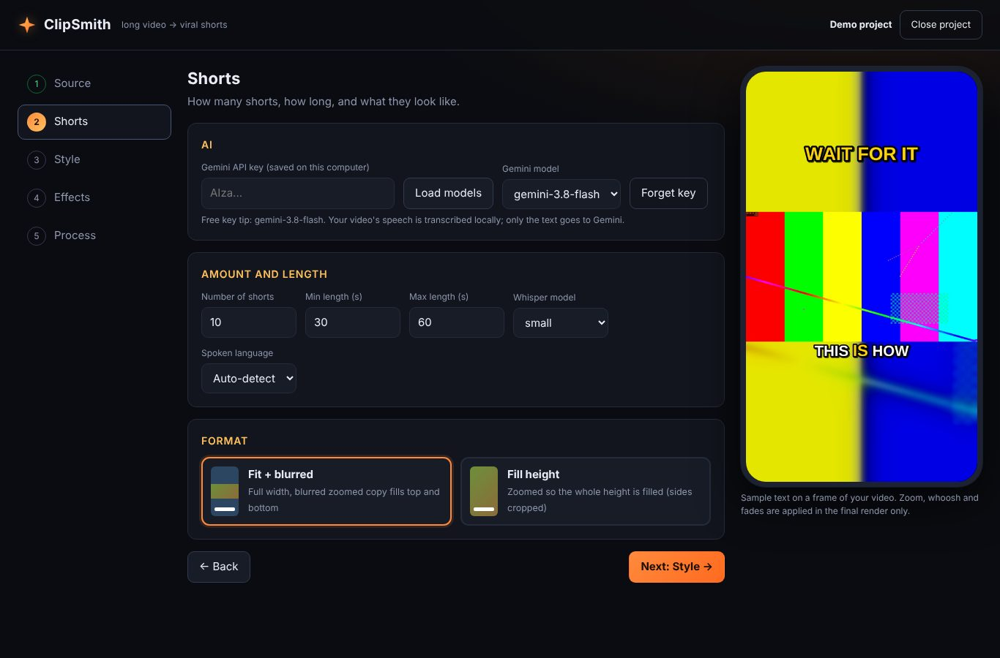
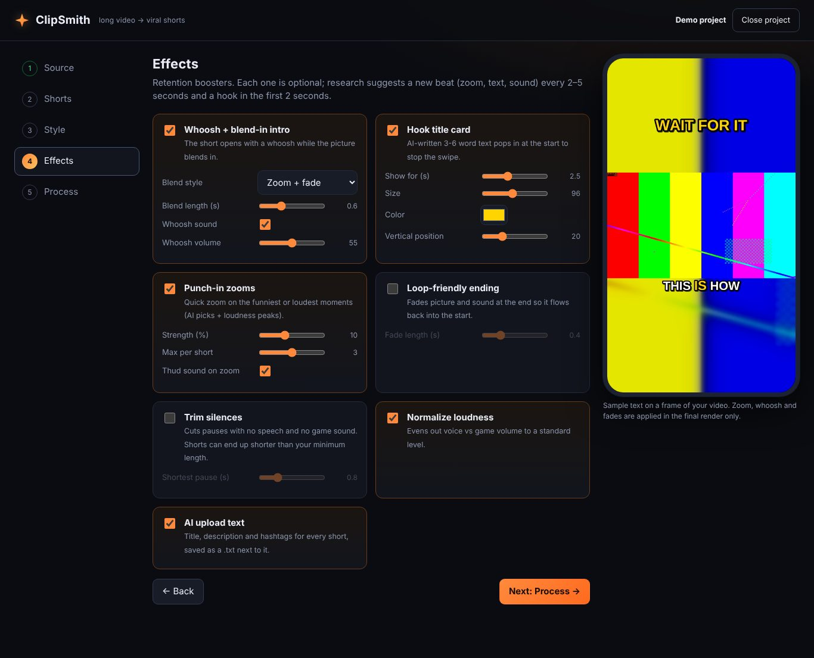
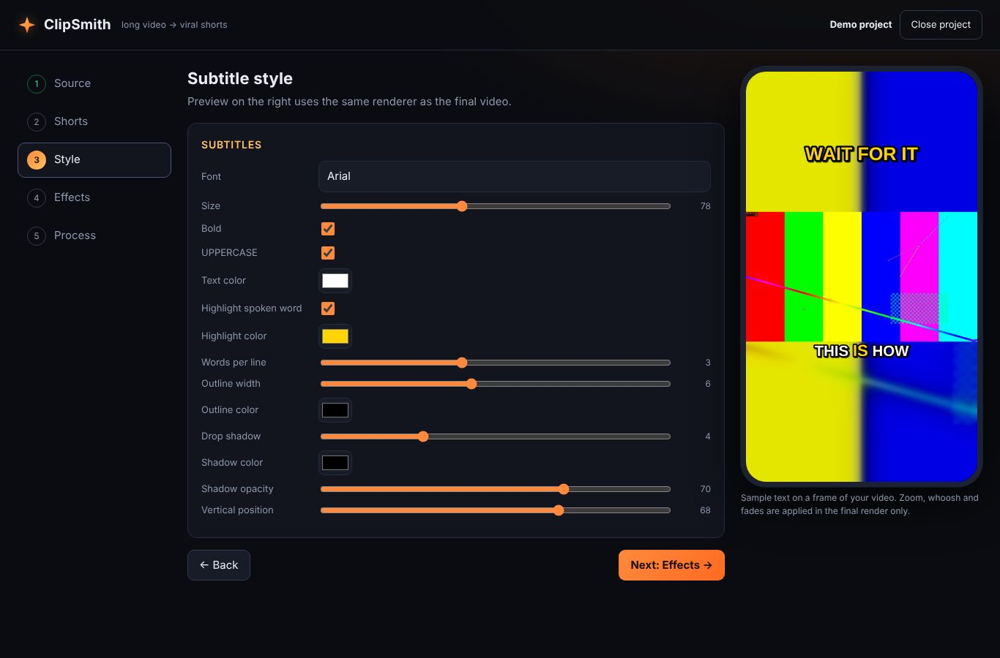

# ClipSmith

**Turn a long Minecraft video into ready-to-upload YouTube Shorts, automatically.**

ClipSmith runs in your browser on your own computer. You give it a long video, an AI (Google Gemini) picks the most
viral moments, and ClipSmith cuts them into vertical 1080x1920 Shorts with animated subtitles, a hook title, a whoosh
intro, punch-in zooms and more. It also writes a title, description and hashtags for each Short.



## What it does

1. **Transcribes** your video locally (word-level timestamps, [faster-whisper](https://github.com/SYSTRAN/faster-whisper)).
2. **Finds the viral moments.** The transcript text is sent to Gemini with a prompt tuned for Minecraft
   (clutch saves, fails, chaotic banter, big reveals, strong reactions). It picks the best N moments that fit your length range.
3. **Cuts** each moment, optionally trimming dead air.
4. **Styles** it: vertical layout, subtitles, effects.
5. **Renders** the finished Shorts and saves every step in its own folder, so an interrupted run can be resumed.

### Features

| | |
|---|---|
| **Amount and length** | Choose how many Shorts (e.g. 10 or 15) and the min/max length (default 30-60 s). |
| **Two formats** | *Fit + blurred*: video at full width over a zoomed, blurred copy of itself. *Fill height*: zoomed so the whole height is filled (with a crop-position slider). |
| **Subtitle styler** | Font, size, bold, uppercase, colors, spoken-word highlight, words per line, outline, drop shadow, position, with a live preview rendered by the same engine as the final video. |
| **Whoosh + blend-in intro** | The Short opens with a whoosh while the picture blends in (zoom + fade, fade from black, or white flash). |
| **Hook title card** | AI-written 3-6 word text that pops in at the start. |
| **Punch-in zooms** | Quick zooms on the funniest or loudest moments (AI picks + loudness peaks) with a thud sound. |
| **Loop-friendly ending** | Short fade at the end so the Short flows back into its start. |
| **Trim silences** | Cuts pauses with no speech *and* no game sound. |
| **Normalize loudness** | Evens out voice vs game volume. |
| **AI upload text** | Title, description and hashtags for each Short, shown in the app and saved as a `.txt`. |
| **Resumable projects** | Every step is saved; reopen a project (or its `project.json`) and continue where it stopped. |
| **Remembers your setup** | Your API key and last-used settings are saved for the next session. |

Every effect is optional and can be switched on or off.



## Requirements

- **Python 3.10 or newer** (3.10-3.12 recommended)
- **ffmpeg 4.4 or newer** with libass (standard builds include it)
- **A Gemini API key**, free to create (see below)
- Optional: an NVIDIA GPU for much faster transcription (CPU works, just slower)

Developed and used on Windows; the processing pipeline was also tested on Linux. macOS should work but is untested.

## Get a Gemini API key

ClipSmith uses Google's Gemini AI to decide which moments are worth turning into Shorts, so it needs an API key.

1. Go to **[aistudio.google.com](https://aistudio.google.com)** and sign in with your Google account.
2. Accept the terms and confirm your region if asked (the API is not available in every country).
3. Click **Get API key** in the left sidebar (or open [aistudio.google.com/app/apikey](https://aistudio.google.com/app/apikey)).
4. Click **Create API key**. Use a new project (the default) or an existing one.
5. **Copy the key.** It starts with `AIza`.
6. Paste it into ClipSmith (step *Shorts* -> *Gemini API key*) and click **Load models**.

Good to know:

- **Cost:** creating a key is free, and the Flash-family models have a free tier with rate limits (no billing needed). Limits
  and model availability change, so check your AI Studio dashboard. ClipSmith needs roughly one request per video
  (a few for very long videos). If you link a billing account, the project moves to the paid tier and usage is charged.
- **Privacy:** on the free tier Google may use your prompts to improve its products, and in the EEA, Switzerland and the UK
  free keys may be limited to your own testing. Only the **transcript text** is sent to Gemini; your video and audio never leave your computer.
- **Keep the key secret.** ClipSmith saves it in `user_prefs.json` on your computer (plain text, excluded from Git).
  Never post it or commit it. Use **Forget key** in the app to remove it.
- **Model choice:** a Flash model such as `gemini-3.8-flash` is plenty for this job. Click **Load models** to see what your key can use.
  If a model is overloaded (HTTP 503), ClipSmith waits and retries, then falls back to another model automatically.

## Install and run

Get the code: `git clone https://github.com/sho310gh/clipsmith.git`, or download the ZIP from GitHub and unzip it.

**Install ffmpeg first** and check that `ffmpeg -version` works in a new terminal:

| System | Command |
|---|---|
| Windows | `winget install ffmpeg` |
| macOS | `brew install ffmpeg` |
| Debian/Ubuntu | `sudo apt install ffmpeg` |

**Windows:** double-click `run.bat`. The first run creates a virtual environment and installs everything (a few minutes).

**macOS / Linux:** `bash run.sh`

**Manual:**

```bash
python -m venv .venv
# Windows: .venv\Scripts\activate      macOS/Linux: source .venv/bin/activate
pip install -r requirements.txt
python app.py
```

Then open **http://127.0.0.1:5000** in your browser.

The first transcription downloads the Whisper model (the default `small` is roughly 0.5 GB; `large-v3` is several GB).

> **Tip:** keep the ClipSmith folder outside Google Drive, OneDrive or Dropbox. Sync clients lock files while uploading and
> would try to sync gigabytes of video.

**Optional NVIDIA GPU speed-up:** `pip install -r requirements-gpu.txt` (about 1 GB). Without it, or if the GPU libraries are
missing, ClipSmith automatically falls back to CPU. To skip the GPU attempt, set the environment variable `WHISPER_DEVICE=cpu`.

## How to use it

The app is a five-step wizard.

1. **Source.** Create a project: upload your video, or paste the path of a file on your computer (faster for big videos, nothing is copied).
   Or resume an earlier project from the list, or by choosing its `project.json`.
2. **Shorts.** Enter your Gemini API key, click **Load models** and pick one. Set the number of Shorts, the min/max length, the format, the
   Whisper model and the spoken language.
3. **Style.** Adjust the subtitles. The phone preview updates live.
4. **Effects.** Switch on the effects you want and tune them.
5. **Process.** Click **Start processing**. Progress is shown per step. You can cancel at any time and **Resume** later.
   When it finishes, preview each Short, download it, and copy its title, description and hashtags.

Changing settings after a run only redoes what is needed. For example, changing the subtitle style re-renders the Shorts but does not
transcribe or ask Gemini again.



## Where your files go

Everything for a project lives in `projects/<name>-<id>/`:

```
project.json        settings and progress (open this to resume)
01_source/          your video (only if you uploaded it)
02_transcript/      transcript with word timestamps
03_analysis/        what Gemini picked (segments.json + raw replies)
04_cuts/            the raw cut of each moment
05_subtitles/       .ass (styled) and .srt subtitle files
06_shorts/          the finished Shorts (.mp4) and their upload text (.txt)
```

The finished Shorts are 1080x1920, H.264 video and AAC audio.

## Customize

- **What counts as viral:** edit `VIRAL_PROMPT` in `pipeline/analyze.py`. It is written for Minecraft but works for other gameplay.
- **Sounds:** the whoosh and thud are generated on first use as `sfx/whoosh.wav` and `sfx/pop.wav`. Replace them with your own files.
- **Fonts:** drop `.ttf` or `.otf` files into `fonts/` and restart. They appear in the font box.
- **Defaults:** your last-used settings are stored in `user_prefs.json` and become the defaults for new projects.

## Troubleshooting

| Problem | Fix |
|---|---|
| `503 UNAVAILABLE` / "high demand" from Gemini | Google's servers are busy. ClipSmith retries and switches model automatically; if it still fails, wait a few minutes and press **Resume** (finished steps are kept) or pick another model. |
| `cublas64_12.dll is not found` | Your GPU libraries are missing. ClipSmith falls back to CPU by itself. For GPU speed run `pip install -r requirements-gpu.txt`. |
| `[WinError 5] Access is denied` on `project.json` | A sync client or antivirus is locking the file. Move ClipSmith out of Google Drive/OneDrive/Dropbox. |
| `ffmpeg` not found | Install ffmpeg and open a new terminal so it is on your PATH. |
| Gemini says the key is invalid | Re-copy the key from AI Studio, then click **Forget key** and paste it again. |
| "Cache entry deserialization failed" during install | A harmless pip warning. `pip cache purge` clears it. |
| Trimmed Short is shorter than the minimum | Silence trimming removes time. Turn it off or lower the minimum length. |

## Limitations

- The AI judges moments from **what is said**, so quiet moments with no commentary are less likely to be picked.
- Word timing comes from Whisper and can be slightly off on noisy audio. A bigger Whisper model is more accurate but slower.
- The effects are tuned by feel; use the toggles and sliders to match your style.

## Credits and license

Inspired by [ViralCutter](https://github.com/RafaelGodoyEbert/ViralCutter). Built with [Flask](https://flask.palletsprojects.com/),
[faster-whisper](https://github.com/SYSTRAN/faster-whisper), [FFmpeg](https://ffmpeg.org/) and the
[Google Gen AI SDK](https://github.com/googleapis/python-genai).

Released under the [MIT License](LICENSE).

ClipSmith is an independent project. It is not affiliated with or endorsed by Mojang, Microsoft, Google or YouTube.
Minecraft is a trademark of Mojang AB.
